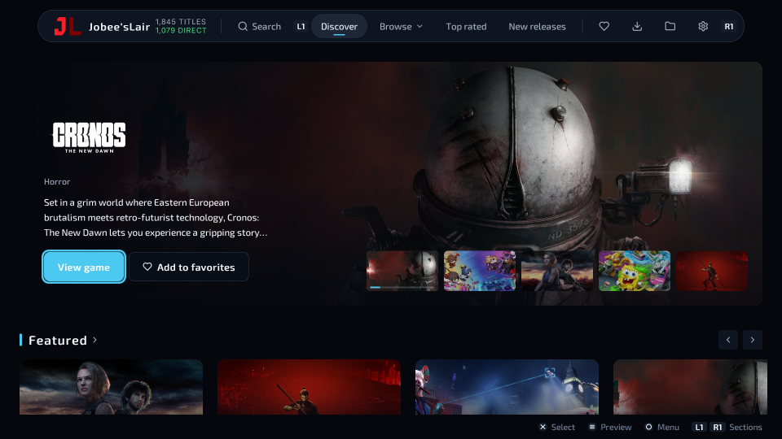
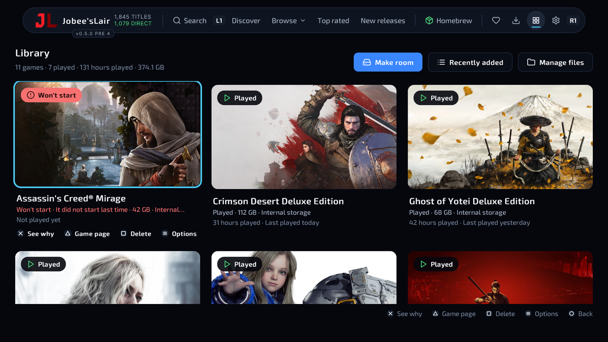
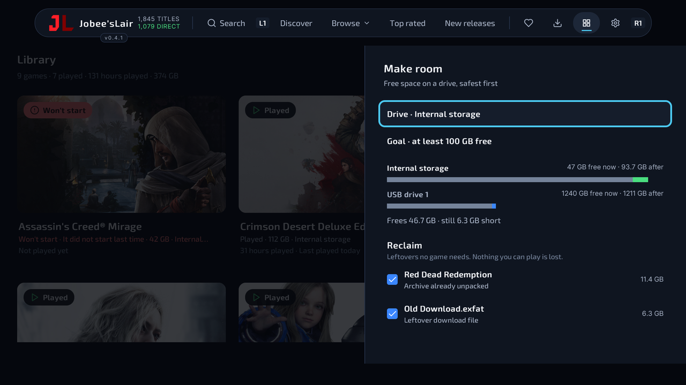
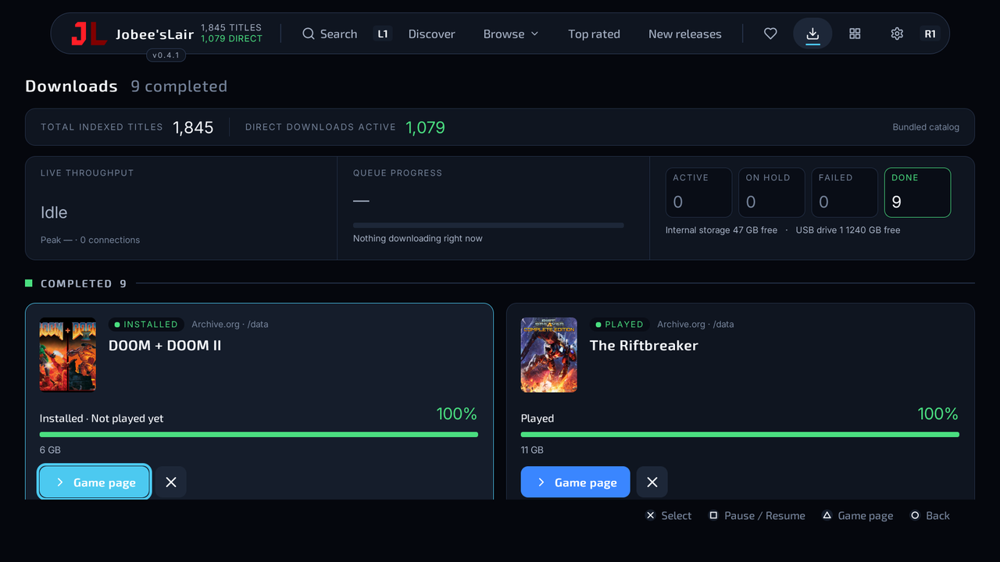
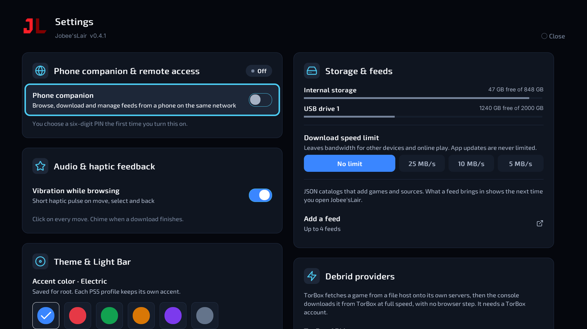

<p align="center">
  <picture>
    <source media="(prefers-color-scheme: dark)" srcset=".github/readme/logo-dark.svg">
    
  </picture>
</p>

<p align="center">
  <b>English</b> ·
  <a href="README.ru.md">Русский</a>
</p>

<p align="center">
  <b>An open-source homebrew download manager for the PS5.</b><br>
  Version 0.2.3 · Title ID <code>PPSA99058</code> · created by JVK3R<br>
  <i>Proudly created alongside AI by JVK3R</i>
</p>

<p align="center">
  <a href="https://buymeacoffee.com/jvk3r"></a>
</p>

<p align="center">
  <a href="INSTALLATION-GUIDE.md">Installation guide</a> ·
  <a href="#why-this-project-exists">Why it exists</a> ·
  <a href="#features">Features</a> ·
  <a href="FEEDS.md">Catalog feeds</a> ·
  <a href="#origin-and-independence">Origin</a> ·
  <a href="#content-neutrality--dmca-notice">Content neutrality &amp; DMCA</a> ·
  <a href="#build-it-yourself">Build it yourself</a> ·
  <a href="#support-the-project">Support</a> ·
  <a href="#credits">Credits</a>
</p>

> [!WARNING]
> **You are responsible for what you download.** Jobee'sLair downloads files directly to your
> console from the sources you point it at. Only download content you **legally own** or have
> **explicit permission** to access: your own backups, homebrew, freeware, and content whose
> rights holder allows it. Do not use Jobee'sLair to obtain games or other material you have no
> right to. The developer does not host or distribute any copyrighted content (see the
> [Content Neutrality &amp; DMCA Notice](#content-neutrality--dmca-notice)), and you alone are
> accountable for complying with the laws where you live.

<p align="center">
  
</p>

## Why this project exists

Jobee'sLair is in **active, ongoing development**. The goal is simple: to become the best
open-source homebrew download manager on the PS5, and to stay that way.

It is open source because tools like this should never disappear or be locked away. Closed
homebrew can vanish overnight: a developer moves on, a server shuts down, a download link dies,
and everyone who relied on it is left with nothing. With every line of source public, anyone can
audit it, build it, fix it, fork it and carry it forward. Nobody, including its own developer, can
take it away from the people who use it.

### Where we stand

We believe that **people who buy hardware should own it**. Sony has repeatedly made choices that
work against its own customers: purchased digital content that can be pulled from libraries,
consoles that will not run software their owners write themselves, ever more of the experience
gated behind subscriptions and online services that can be switched off, and repair and
preservation made harder rather than easier. We think that is the wrong direction.

Jobee'sLair is part of pushing back: open tools, documented in public, that give owners more
control over the machines they paid for and help preserve the ability to use them long after a
storefront or service is gone. We want **change and freedom for all gamers**: the freedom to run
your own software, to keep and back up what you own, and to decide how your own console is used.

Pushing for freedom is not a licence to take other people's work. Supporting the developers and
artists who make the games you love is part of the same fight. **Download only what you own or
are allowed to download.**

## Features

- **A modern, controller-first interface**: a floating navigation dock, rounded cards that rise
  smoothly under the accent focus frame, screens that slide in, and a deep dark theme with monospace
  telemetry readouts where numbers matter
- **A live library counter** in the dock and on the dashboard: total indexed titles and how many of
  them have a direct download, counted across the bundled catalog and every feed you added, and
  updated as feeds refresh or fall back to a mirror
- **Downloads dashboard**: a live telemetry band (throughput with a one-minute trace, overall queue
  progress and time left, counts by state, free space per drive) above a card for every job, with
  progress meters, speed, and Pause, Resume, Retry, Install and Cancel controls
- **Downloads straight to the console**, to internal storage or a USB or extended drive, with the
  drive's space read off the interface thread so a sleeping drive cannot freeze the screen
- **Link health**: a game's download links are checked in the background while you look at it (a
  HEAD request each, only while no download needs the network), or all at once with **Check link
  health** in its source list. A link that is gone (404 or 410, confirmed by a second request) is
  greyed out as **Link unavailable** and never picked; one that keeps timing out is tagged **Not
  responding** and ranked after the hosts that answer, and the best healthy mirror is picked instead.
  Rate-limited hosts are left alone, and nothing is marked on a single failed request
- **A couch library** of the games on the console, each tile with its readiness (Installed, Played,
  Won't start) and its **play time** ("42 hours played · Last played yesterday"), read from
  ShadowMount+'s session log; sort by last played, most played, size or newest
- **Make Room**: when a download doesn't fit, or from the library, a side sheet frees the drive
  safest first: leftovers no game needs (unpacked archives, stale partial files, archive notes,
  backports of removed games), then the games you haven't played in a while moved to another drive,
  then only the games you tick for deleting. Bars show each drive before and after; downloads pause
  until the drive has room and the waiting download starts once it does. Games you keep on internal
  storage and your five most played stay put
- **Moving games between drives** from a tile's Options: copied on a background thread, read back
  byte for byte against the original (and its download receipt), and only then removed from where it
  was; a move that is cut off resumes from where it stopped. ShadowMount+ is told the game's new
  place
- **Delete from disk** from the library, the Files screen or a game's page: a mounted image is
  unmounted first and never deleted while mounted; the game's image or folder, its partial files,
  extracted files, backport and `-extras` notes go; then ShadowMount+ is asked to uninstall it. While
  Jobee'sLair is open ShadowMount+ refuses uninstalls, and the app says the tile goes once it is
  closed. A download in progress pauses for the few seconds this takes and resumes after
- **Deeper ShadowMount+ integration**: readiness from ShadowMount+'s own log, with **See why** for
  a game that won't start (the log lines of its last launch); a monitor that flags a game whose file
  ShadowMount+ can no longer reach; games moved by another tool are followed to their new place.
  Background requests never queue behind a download and back off when ShadowMount+ stops answering
- **Your own catalog feeds, built to survive takedowns**: add up to 4 JSON feeds from the controller
  or your phone, each with **mirror addresses** (yours, and the ones the feed lists itself). If a
  feed's domain goes down, a refresh falls back to a mirror, and the last good copy stays on the
  console when everything is down ([FEEDS.md](FEEDS.md))
- **Phone companion** on port `34177`: browse and queue from your phone, watch the queue and storage
  live, manage feeds and their mirrors, and use it as a virtual remote. **You choose its 6-digit PIN
  the first time you turn it on**; it is kept on the console and only you can change it
- **Updates**: Jobee'sLair looks at the latest release of
  [JVK3R/JobeesLair](https://github.com/JVK3R/JobeesLair) at launch and every 24 hours, and shows a
  badge in the header when a newer build exists. **Download and install** fetches the release's
  `update.zip` and `JobeesLair.exfat` in the background, while your own downloads are idle. Each file
  is checked against GitHub's SHA-256, and `update.zip` must name this title and version. The image is
  staged beside the installed one. **Restart to apply** closes the app; a small payload
  (`updater.elf`) swaps the image in once ShadowMount+ has released it, then opens the app again. If
  the new version does not start, the payload puts the old one back. With **Install updates
  automatically** on in Settings, this happens by itself the next time the app closes
  ([details](INSTALLATION-GUIDE.md#7-updating-and-removing))
- **Theme profiles**: six accent colors (Electric, Crimson, Emerald, Amber, Violet, Graphite) over
  the dark base, saved separately for each PS5 user profile
- **DualSense status light**: a slow breath in your accent when idle, green that brightens with
  download progress, amber when paused, red on errors (can be turned off in Settings)
- **Built-in Source Addition Guide** in Settings, haptic feedback as you move, and **13 languages**
- Made for the controller: <kbd>L1</kbd> <kbd>R1</kbd> to switch sections, <kbd>✕</kbd> to select,
  <kbd>○</kbd> to go back, <kbd>□</kbd> to pause or resume a download, <kbd>△</kbd> for its game page;
  in the library <kbd>□</kbd> twice deletes a game and <kbd>Options</kbd> opens its menu (move, keep on
  internal storage, Make Room)

<p align="center">
  
  
</p>

<p align="center">
  
  
</p>

## Install

The full walkthrough, from copying the image to choosing your phone PIN and adding feeds, is in
**[INSTALLATION-GUIDE.md](INSTALLATION-GUIDE.md)**. In short:

1. You need a **jailbroken PS5** running **[ShadowMount+](https://github.com/drakmor/ShadowMountPlus)**.
2. Copy `JobeesLair.exfat` into a folder named `homebrew` at the top of an exFAT USB drive.
3. Plug the drive into the PS5. ShadowMount+ installs it and shows a notification.
4. Open **Jobee'sLair** from the home screen.

> [!IMPORTANT]
> The phone companion is **off until you turn it on**, and it asks you to choose a PIN first. Pick
> one you do not use elsewhere. Anyone on the same network who knows the PIN can sign in while the
> companion is on. Wrong guesses are slowed down and locked out after 20, but on a shared or public
> network, keep the companion off when you are not using it.

## Origin and independence

Jobee'sLair was originally inspired by an open-source fork of Overdrive. Since then its interface,
phone companion, feed system, download dashboard and update check have been redesigned and rewritten,
and it is developed independently under its own name, by its own author, from its own repository.
It is not affiliated with, endorsed by, or a continuation of Overdrive or its authors. The people and
projects it builds on are credited below.

## Content Neutrality & DMCA Notice

Jobee'sLair is an open-source, user-driven utility: a download manager and catalog browser for
homebrew on a jailbroken PS5. It is a tool for fetching the files you point it at, not a content
service.

- **No copyrighted files are hosted here.** Jobee'sLair does not host, store, stream or distribute
  copyrighted binary media or proprietary game data: not on any server run by the project, not in
  this repository, and not inside the app image (there are no game packages, disc images, keys or
  firmware in it). When you start a download, your console fetches the file directly from the
  third-party address named in the source.
- **What the repository does contain.** A bundled catalog (`app/data/`) of titles, identifiers,
  descriptions, cover-image links and references to third-party download addresses, so the store
  has something to show before you add anything. It is an index, not the files. The project does
  not operate, control or vouch for the servers behind those addresses.
- **Your feeds and mirrors are yours.** The feed addresses and mirror lists you add are chosen and
  configured by you, and they are fetched and parsed on your console (client-side) when you refresh.
  The project runs no feed server, does not see which feeds you add or what you download, and does
  not curate them. A mirror is only used to fetch the feed file; it changes nothing about how a
  game downloads.
- **You are responsible for what you add and download.** Use Jobee'sLair only with content you own
  or have permission to access.

### Reporting an infringing feed manifest or catalog entry

If you hold the rights to a work and believe a catalog entry in this repository, or a feed or mirror
address published in its documentation, infringes them:

1. Open a **[Takedown / copyright notice](https://github.com/JVK3R/JobeesLair/issues/new?template=takedown.yml)**
   issue, or send the same information through GitHub's own
   [DMCA process](https://docs.github.com/en/site-policy/content-removal-policies/dmca-takedown-policy)
   naming this repository (issues are public, so use that route if you would rather not post your
   contact details). Include:
   - the copyrighted work, and who owns the rights;
   - where the infringing entry is: for a bundled entry, its file and title ID (for example
     `app/data/releases/PPSA00000.json`); for a feed or mirror, its exact address;
   - your name and a way to contact you or the rights holder;
   - a statement that you have a good-faith belief the use is not authorized by the owner, its agent
     or the law;
   - a statement, under penalty of perjury, that the notice is accurate and that you are the owner
     or authorized to act for the owner, with your physical or electronic signature.
2. A complete notice is reviewed promptly. The entries it identifies in this repository are removed
   or disabled in a following commit and release.
3. A feed or mirror hosted by someone else is outside the project's control, and the project cannot
   remove a file from a server it does not run. Send the notice to whoever hosts it as well. Only
   the person who added a feed to their own console can remove it from that console.
4. Whoever is responsible for a removed entry may reply with a counter-notice containing the same
   details, and it is handled as the DMCA and GitHub's process provide.

This notice describes how the project is built and run. It is not legal advice, and it does not
change the license in [LICENSE](LICENSE).

## Status

Jobee'sLair 0.2.3 adds link health checks and fixes the space check for downloads of unknown size; 0.2.1 added installing updates from the app. The 0.1.1 betas were tested on a PS5
running firmware 13.60 with ShadowMount+ 1.7. Every build passes its automated tests (the app's logic suites, the framework's
tests, and the native server and drive-probe tests under AddressSanitizer, UndefinedBehaviorSanitizer
and ThreadSanitizer), but not every feature has been confirmed on PS5 hardware yet. Report what you
find, with your firmware and loader.

## Build it yourself

<details>
<summary><b>What's in this repository</b></summary>
<br>

| Path | What it is |
| --- | --- |
| `app/` | The application: JSX sources, state, assets, catalog data, and `app.json` (title ID `PPSA99058`, package version `01.002.003`, capabilities) |
| `app/version.js` | The app version (`0.2.3`), the creator credit (`JVK3R`) and the official repository the update check reads |
| `app/ui/JLMark.jsx` | The "JL" monogram as native vector paths (`.github/readme/logo.svg` is the same mark as a file) |
| `app/state/library-count.js` | The live indexed-titles and direct-downloads counter |
| `LICENSE` | GPL-3.0-or-later, followed by the content neutrality and DMCA notice |
| `ps5-react/` | The framework it runs on, vendored from [half144/ps5-react](https://github.com/half144/ps5-react), with its native host and tests |
| `packaging/make-exfat.sh` | Builds the exFAT image ShadowMount+ installs |
| `packaging/stage-docs.sh` | Adds this documentation to the image, as `/docs` |
| `INSTALLATION-GUIDE.md` | Installing, choosing the phone PIN and adding feeds |
| `FEEDS.md` | The catalog feed format, including mirrors |

</details>

<details>
<summary><b>Building</b></summary>
<br>

On any Linux (or WSL) with `clang-18`, `llvm-18`, `cmake`, `ninja-build`, `nodejs`, `npm`,
`zlib1g-dev`, `build-essential`, `pkg-config`, `unzip`, `curl`, `exfatprogs`, and Pillow from
`ps5-react/requirements.txt`:

```sh
cd ps5-react
python3 tools/build_ps5.py --app-dir ../app --llvm /usr/bin
cp -a dist/PPSA99058 ../stage                 # a copy, so dist stays as verify.py checked it
../packaging/stage-docs.sh ../stage           # adds these docs to the image as /docs
sudo ../packaging/make-exfat.sh ../stage ../JobeesLair.exfat JOBEESLAIR
```

The build downloads its pinned dependencies into `ps5-react/.deps`, writes the app folder, a `.zip`
and a `.receipt.json` into `ps5-react/dist`, and verifies the result itself (`tools/verify.py`).
The image is a plain exFAT volume whose root is the app folder, with 64 KiB clusters and the label
`JOBEESLAIR`.

To publish a build, raise the version in `app/version.js`, run the build workflow, test the draft's
image on a console, then publish the draft with a tag of the same version (`v0.2.3`): the
update check in installed copies compares that tag with their own version. To let installed copies
install it themselves, attach both `JobeesLair.exfat` and `update.zip` (`ps5-react/dist/PPSA99058.zip`
renamed). GitHub publishes each asset's SHA-256, and a release without both files only offers the
release page.

</details>

## Support the project

Jobee'sLair is free and open source, and it stays that way. Every feature, download and update is
there for everyone. Nothing is locked, limited or held back, and the app never asks for money: no
pop-ups, no reminders.

If you'd like to support its development and future PS5 homebrew tools, you can
**[buy me a coffee ☕](https://buymeacoffee.com/jvk3r)**. The same link is under
**Settings → About → Support development** in the app, as a QR code for your phone. Thank you.

## Credits

- **JVK3R**, creator of Jobee'sLair.
- **[MyLuxy](https://github.com/MyLuxy)**, author of the open-source Overdrive fork that Jobee'sLair
  was originally inspired by.
- **PS5 React — created by half144 and PS5 React contributors.**
  [github.com/half144/ps5-react](https://github.com/half144/ps5-react)
- **[ShadowMount+](https://github.com/drakmor/ShadowMountPlus)** by drakmor, which installs it.

Jobee'sLair is distributed under the GPL-3.0-or-later (see [LICENSE](LICENSE)), the license of the
PS5 React framework it is built on. `ps5-react/` also carries its own `LICENSE`,
`LICENSE-ATTRIBUTION` and `NOTICE`.
Every dependency notice is copied into `notices/` inside the built app, and
`ps5-react/docs/DEPENDENCIES.md` lists them with their sources.

<sub>Jobee'sLair is an unofficial homebrew project and is not affiliated with or endorsed by Sony
Interactive Entertainment. PlayStation and PS5 are trademarks of Sony Interactive Entertainment.</sub>
