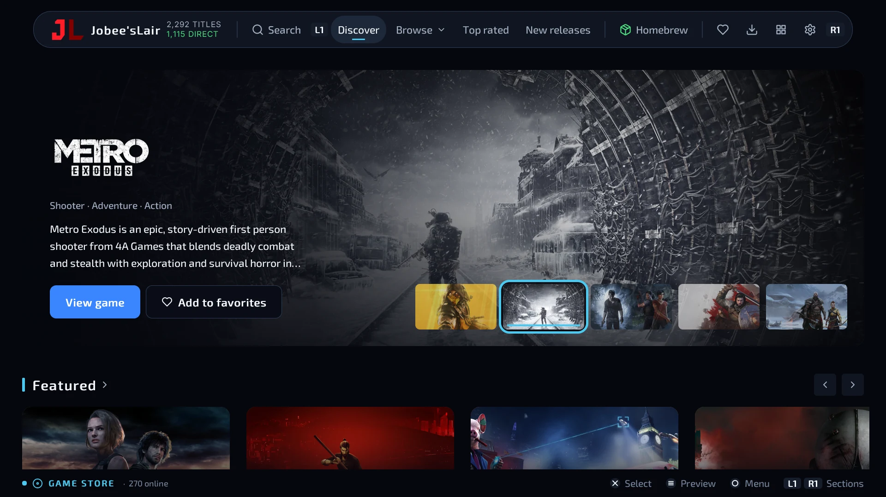
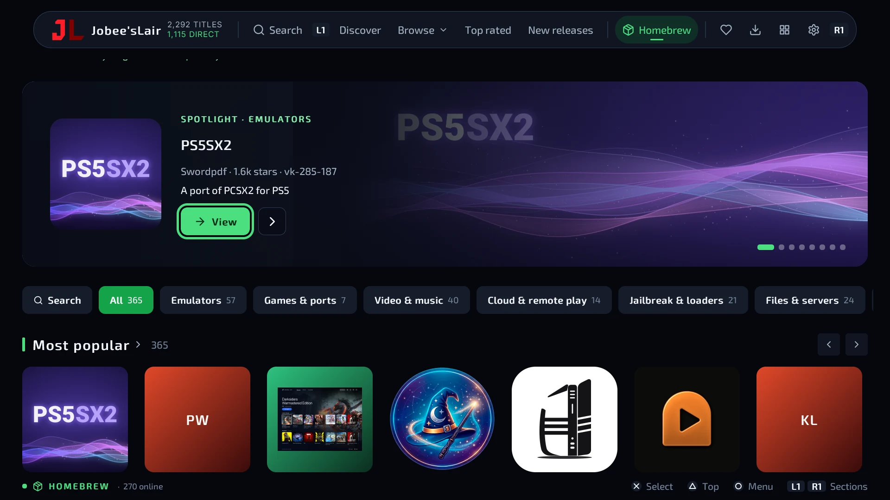
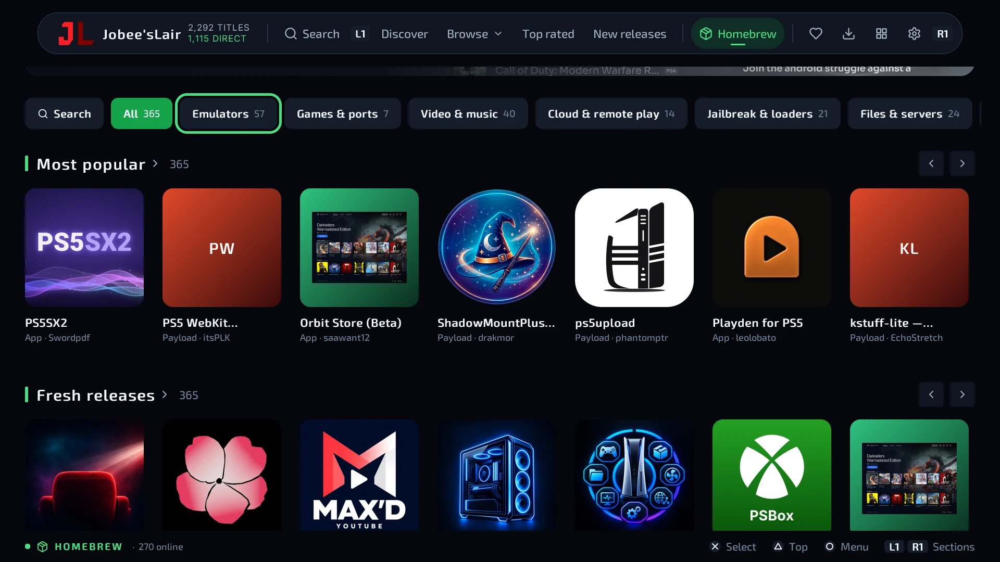
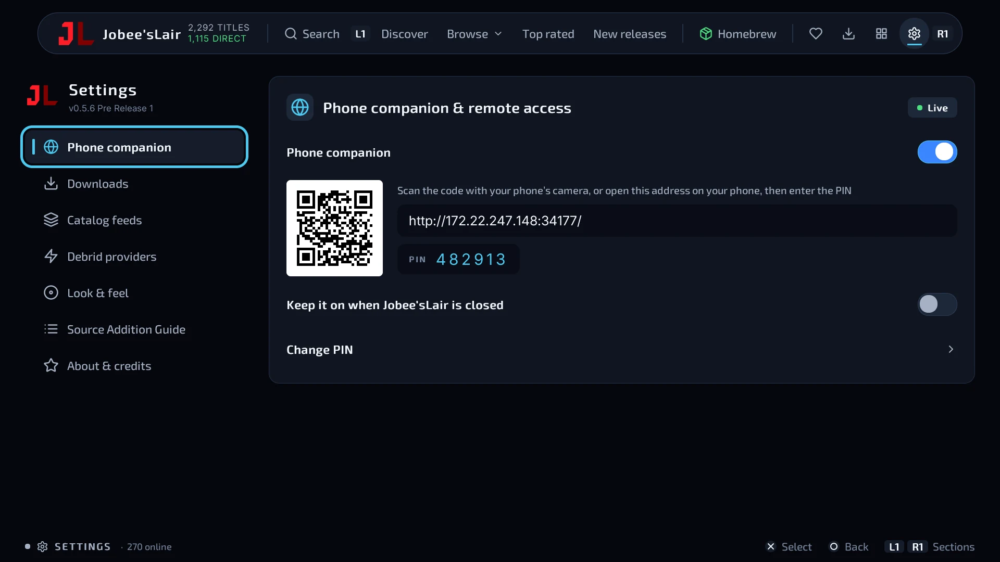
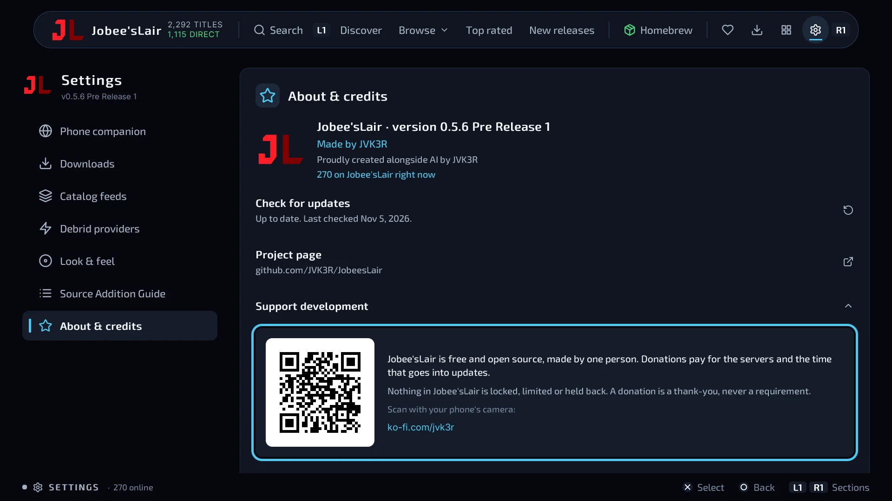
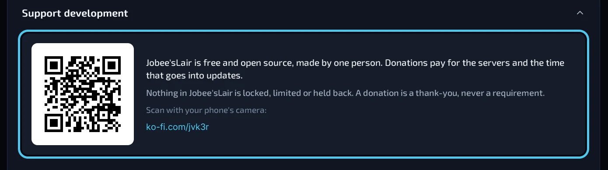

<p align="center">
  <picture>
    <source media="(prefers-color-scheme: dark)" srcset=".github/readme/logo-dark.svg">
    
  </picture>
</p>

<p align="center">
  <b>English</b> ·
  <a href="README.ru.md">Русский</a>
</p>

<p align="center">
  <b>An open-source homebrew download manager for the PS5.</b><br>
  Title ID <code>PPSA99471</code> · created by JVK3R<br>
  <i>Proudly created alongside AI by JVK3R</i>
</p>

<p align="center">
  <a href="https://github.com/JVK3R/JobeesLair/releases/latest"></a>
  <a href="https://github.com/JVK3R/JobeesLair/releases"></a>
  <a href="https://ko-fi.com/jvk3r"></a>
  <a href="https://discord.gg/w5dtAMBVgZ"></a>
</p>

<p align="center">
  <a href="INSTALLATION-GUIDE.md">Install guide</a> ·
  <a href="CHANGELOG.md">Changelog</a> ·
  <a href="FEEDS.md">Catalog feeds</a> ·
  <a href="#support-jobeeslair">Support</a> ·
  <a href="https://jobees.org">jobees.org</a> ·
  <a href="https://github.com/JVK3R/JobeesLair-PS4">The PS4 app</a>
</p>

> [!IMPORTANT]
> **All official communications are here on Discord or Twitter:**
> [Discord](https://discord.gg/w5dtAMBVgZ) · [Twitter / X (@jvk3r_)](https://x.com/jvk3r_)

> [!WARNING]
> **You are responsible for what you download.** Only download content you legally own or have
> permission to access: your own backups, homebrew, freeware. Jobee'sLair hosts and distributes
> nothing; see the [Content Neutrality & DMCA Notice](#content-neutrality--dmca-notice).

<p align="center">
  
</p>

> [!TIP]
> **Jobee'sLair is free and made by one person.** If it's useful to you, [support it on Ko-fi](https://ko-fi.com/jvk3r)
> or [with crypto](#support-jobeeslair). Donations keep the servers running and the updates coming.

Jobee'sLair is a catalog browser and download manager that runs on a jailbroken PS5 with
[ShadowMount+](https://github.com/drakmor/ShadowMountPlus). It is open source so it can't be locked away
or disappear: anyone can read, build, fix and fork it.

## What it does

- **Homebrew, its own section:** 300+ open-source PS5 apps, emulators, ports and payloads, each with its
  own art, installed and kept up to date straight from its author's GitHub release (nothing is rehosted).
  Apps land in `homebrew/` for ShadowMount+; payloads run through your ELF loader with one button.
- **Browse and download** a bundled catalog of games, plus up to 4 catalog feeds of your own
  (with mirror addresses, so a feed survives its domain going down). Downloads go straight to internal
  storage or a USB drive, and the drive you picked is remembered.
- **Labels every source** before you download: what it is (Folder Dump, .exfat Image, FFPKG, Backport),
  whether it runs on firmware 13.60 (**13.60 Ready**), and whether its link still works (**Broken link**,
  **Offline**). A link that stops working for other players is flagged for you too. Nothing is hidden, only ranked.
- **Downloads that look after themselves:** a download that fails part-way retries by itself, and archives
  are unpacked for you, even an archive inside an archive.
- **Catches file links from the console's browser** for you, so there is no typing links with a
  controller, and **learns which hosts work** on your console (**Auto-capture** / **Rarely works here**).
- **TorBox and AllDebrid (optional):** add your key in Settings and supported hosts download at full speed
  with no browser step.
- **Library, play time and Make Room:** see what's installed and how long you played it, free up space
  safely, move games between drives, and find out **why a game won't start**, with how often it starts for
  other players.
- **Phone companion:** a live dashboard, the queue, games and homebrew (install, update, run, remove), your
  library with Fix it, and a remote, from your phone, in the console's language. Downloads and installs move on
  the phone as they happen. Off until you turn it on, and you choose its 6-digit PIN. Experimental: it can stay
  reachable while Jobee'sLair is closed, to open the app or run a payload.
- **Types on the PS5's own keyboard** for searches, links and keys, in your language (or the store's own keys,
  with results as you type, if you prefer them).
- **Updates from the app**, a **download speed limit**, six accent colors, DualSense light-bar status,
  and 14 languages.

<p align="center">
  
  
</p>

<p align="center">
  
  
</p>

## Support Jobee'sLair

Jobee'sLair is free and open source, and it's made by one person. Donations pay for what keeps it running: the
servers behind the live catalog, the update checks and the bug reports, and the time each release takes. Nothing in
the app is locked or held back, and nothing ever will be. A donation is a thank-you, never a requirement.

<p align="center">
  <a href="https://ko-fi.com/jvk3r"></a>
</p>

| How | Where |
| --- | --- |
| **Ko-fi** | [ko-fi.com/jvk3r](https://ko-fi.com/jvk3r): card, Apple Pay or Google Pay, once or monthly |
| **Bitcoin** | `3PeEqA8UTvCuLwR1K5NKP8k11dFAh14rqM` |
| **USDC on Solana** | `6iWHFuvmBgZtUsyF3GmrF2Ng4tAPnBaEJkD8tr7Hm3cX` |

Supporters are thanked by name on [jobees.org/#support](https://jobees.org/#support) (a private gift stays private)
and get the Supporter role on [Discord](https://discord.gg/w5dtAMBVgZ). Gave in crypto? Open a ticket there with the
transaction link.

From 0.5.6 the same Ko-fi code is in the app, under **Settings → About & credits → Support development**:

<p align="center">
  
</p>

## Install

Full steps are in the **[installation guide](INSTALLATION-GUIDE.md)**. In short:

1. Have a **jailbroken PS5** running **ShadowMount+**.
2. Copy `JobeesLair.exfat` into a folder named `homebrew` on an exFAT USB drive (or `/data/homebrew`).
3. Plug it in. ShadowMount+ installs it. Open **Jobee'sLair** from the home screen.

> [!IMPORTANT]
> The phone companion asks you to choose a PIN before it turns on. Pick one you don't use elsewhere, and
> keep the companion off on a shared or public network.

## Content Neutrality & DMCA Notice

Jobee'sLair is a user-driven download tool, not a content service.

- **No copyrighted files are hosted here:** not on a project server, not in this repository, not in the app
  image. Your console fetches files directly from the third-party addresses you choose.
- **The bundled catalog** (`app/data/`) is an index of titles, descriptions, cover links and references to
  third-party addresses. It is not the files, and the project does not run or vouch for those servers.
- **Your feeds and mirrors are yours.** They are fetched and read on your console. The project runs no feed
  server and does not see what you add or download.

**To report an infringing catalog entry, feed or mirror,** open a
[takedown issue](https://github.com/JVK3R/JobeesLair/issues/new?template=takedown.yml) or use GitHub's
[DMCA process](https://docs.github.com/en/site-policy/content-removal-policies/dmca-takedown-policy), naming
this repository. Include the work and its owner, where the entry is (its file and title ID, or the exact
address), your contact details, a good-faith statement that the use is not authorized, and a statement under
penalty of perjury that the notice is accurate and you are the owner or authorized to act. A complete notice
is reviewed promptly and the entries it identifies are removed in a following release. A feed hosted by
someone else is outside the project's control; send the notice to its host too. A counter-notice is handled
as the DMCA and GitHub's process provide.

This notice is not legal advice and does not change the [LICENSE](LICENSE).

## Build it yourself

<details>
<summary><b>Repository layout and build steps</b></summary>
<br>

| Path | What it is |
| --- | --- |
| `app/` | The application (JSX, state, catalog data) and `app.json` (title ID `PPSA99471`) |
| `ps5-react/` | The framework it runs on, vendored from [JVK3R/ps5-react](https://github.com/JVK3R/ps5-react), the continuation of half144's PS5 React |
| `tests/` | The app's tests and benchmarks |
| `packaging/` | Builds the exFAT image and adds these docs to it |
| `INSTALLATION-GUIDE.md`, `FEEDS.md`, `CHANGELOG.md` | Install steps, the feed format, what changed |

On Linux (or WSL) with `clang-18`, `llvm-18`, `cmake`, `ninja-build`, `nodejs`, `npm`, `zlib1g-dev`,
`build-essential`, `pkg-config`, `unzip`, `curl`, `exfatprogs` and Pillow (`ps5-react/requirements.txt`):

```sh
cd ps5-react
python3 tools/build_ps5.py --app-dir ../app --llvm /usr/bin
cp -a dist/PPSA99471 ../stage
../packaging/stage-docs.sh ../stage
sudo ../packaging/make-exfat.sh ../stage ../JobeesLair.exfat JOBEESLAIR
```

The tests need only Node.js 22+ and run on every push: `npm test` (logic), `npm run test:render`
(screens), `npm run test:all` (both).

The Homebrew section's list is nexgen999's [PS5 Repository List](https://github.com/nexgen999/PS5-Repository-List),
read live, plus our own picks and categories. It is built from each project's own GitHub data every six hours
in its own repository, [JVK3R/JobeesLair-Homebrew](https://github.com/JVK3R/JobeesLair-Homebrew), which
consoles read directly; `npm run homebrew:pull` refreshes the copy shipped in the app (`app/data/homebrew.json`)
before a release. The same repository is the home of **Jobee'sLair Homebrew**, the Homebrew section built on its
own (`packaging/homebrew-edition.sh`, title `PPSA99472`), which installs beside the store.

To publish: raise the version in `app/version.js`, build, test the image on a console, then publish a
release tagged with the same version (`v0.5.0`). Attach `JobeesLair.exfat` and `update.zip`
(`ps5-react/dist/PPSA99471.zip` renamed) so installed copies can update themselves.

</details>

## Credits

- **JVK3R**, creator of Jobee'sLair
- **drakmor** ([ShadowMount+](https://github.com/drakmor/ShadowMountPlus))
- **nexgen999** ([PS5 Repository List](https://github.com/nexgen999/PS5-Repository-List)): the Homebrew section's
  list comes from it, with their permission, and grows with it
- **Every homebrew developer** whose work the Homebrew section lists
- **PS5 React — created by half144 and PS5 React contributors.**
  The original repository is gone; the framework continues at
  [github.com/JVK3R/ps5-react](https://github.com/JVK3R/ps5-react), where the changes made for Jobee'sLair live.
- **Nick** and **all testers**: thank you

Distributed under the GPL-3.0-or-later ([LICENSE](LICENSE)). Third-party notices are in `notices/` inside the
app and in `ps5-react/docs/DEPENDENCIES.md`.
