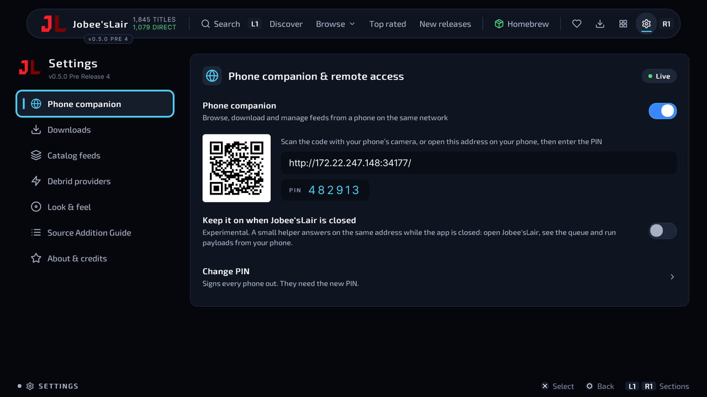
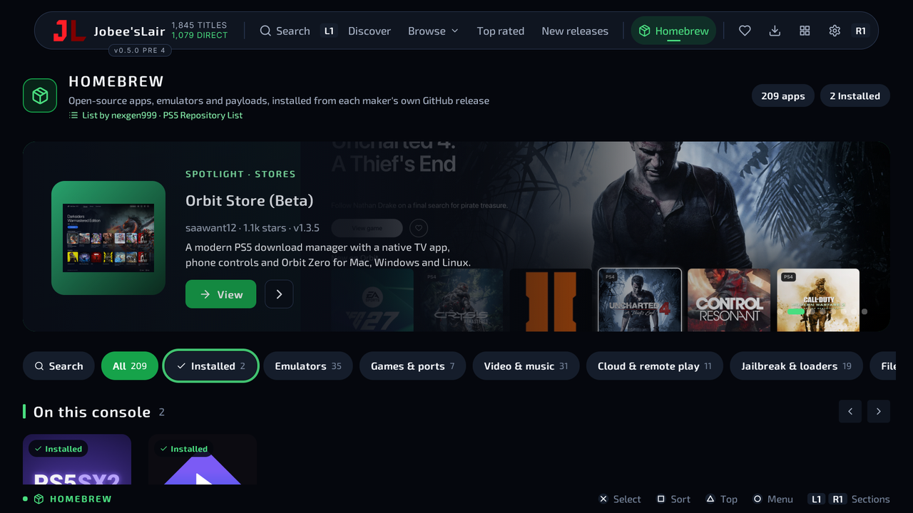
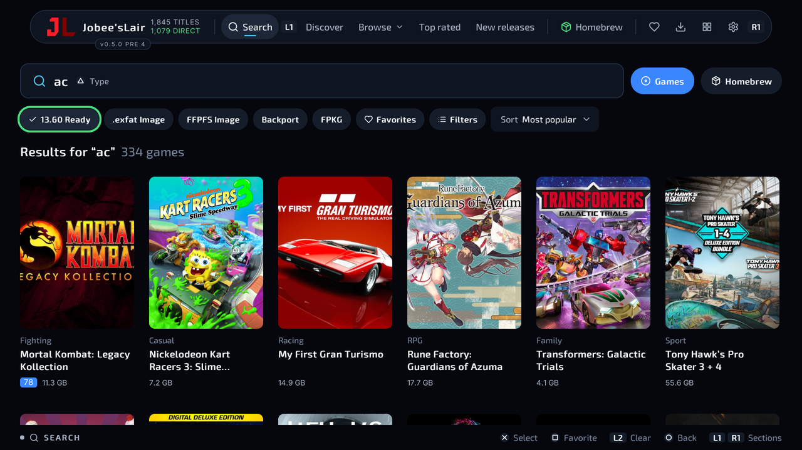

<p align="center">
  <picture>
    <source media="(prefers-color-scheme: dark)" srcset=".github/readme/logo-dark.svg">
    
  </picture>
</p>

<p align="center">
  <a href="README.md">English</a> ·
  <b>Русский</b>
</p>

<p align="center">
  <b>Менеджер загрузок для homebrew на PS5 с открытым исходным кодом.</b><br>
  Версия 0.5.0 · Title ID <code>PPSA99471</code> · автор: JVK3R<br>
  <i>Proudly created alongside AI by JVK3R</i>
</p>

<p align="center">
  <a href="https://github.com/JVK3R/JobeesLair/releases/latest"><b>Скачать</b></a> ·
  <a href="INSTALLATION-GUIDE.md">Руководство по установке (англ.)</a> ·
  <a href="CHANGELOG.md">Список изменений (англ.)</a> ·
  <a href="FEEDS.md">Фиды каталога (англ.)</a> ·
  <a href="https://buymeacoffee.com/jvk3r">☕ Поддержать</a>
</p>

> [!WARNING]
> **Вы сами отвечаете за то, что скачиваете.** Скачивайте только то, чем вы законно владеете или на что у
> вас есть разрешение: собственные резервные копии, homebrew, бесплатные программы. Jobee'sLair ничего не
> размещает и не распространяет; см. [уведомление о нейтральности контента и DMCA](#нейтральность-контента-и-уведомление-dmca).

<p align="center">
  
</p>

Jobee'sLair — это обозреватель каталога и менеджер загрузок для PS5 с джейлбрейком и
[ShadowMount+](https://github.com/drakmor/ShadowMountPlus). Код открыт, чтобы его нельзя было закрыть или
потерять: любой может прочитать, собрать, исправить и сделать форк.

## Возможности

- **Homebrew, отдельный раздел:** более 200 открытых приложений, эмуляторов, портов и пейлоадов для PS5 со
  своими иконками. Устанавливаются и обновляются прямо из релизов авторов на GitHub (ничего не
  перезаливается). Приложения попадают в `homebrew/` для ShadowMount+, пейлоады запускаются через ваш
  ELF-загрузчик одной кнопкой.
- **Каталог и загрузки:** встроенный каталог игр и до 4 собственных фидов (с зеркалами, чтобы
  фид пережил отключение домена). Загрузка идёт сразу во внутреннюю память или на USB-накопитель.
- **Пометки у каждого источника:** что это (Folder Dump, .exfat Image, FFPKG, Backport), запустится ли на
  прошивке 13.60 (**13.60 Ready**) и жива ли ссылка (**Broken link**, **Offline**). Ничего не скрывается,
  источники только ранжируются.
- **Ссылки из браузера консоли ловятся сами:** вводить ссылки геймпадом не нужно. Приложение **запоминает,
  какие хосты работают** на вашей консоли (**Auto-capture** / **Rarely works here**).
- **TorBox (по желанию):** укажите ключ API в настройках, и поддерживаемые хосты скачиваются на полной
  скорости без браузера.
- **Библиотека, время в игре и Make Room:** что установлено и сколько вы играли, безопасное освобождение
  места, перенос игр между накопителями и причина, **почему игра не запускается**.
- **Телефон-компаньон:** живая панель, очередь, игры и homebrew (установка, обновление, запуск) и пульт с
  телефона. Выключен, пока вы его не включите, а шестизначный PIN выбираете вы. Экспериментально: может
  работать и при закрытом Jobee'sLair, чтобы открыть приложение или запустить пейлоад.
- **Обновления из приложения**, ограничение скорости, шесть акцентных цветов, индикатор на DualSense и
  13 языков.

<p align="center">
  
  
</p>

<p align="center">
  
  
</p>

<p align="center">
  
  
</p>

## Установка

Подробности — в **[руководстве по установке](INSTALLATION-GUIDE.md)** (на английском). Коротко:

1. Нужна **PS5 с джейлбрейком** и **ShadowMount+**.
2. Скопируйте `JobeesLair.exfat` в папку `homebrew` на USB-накопителе с exFAT (или в `/data/homebrew`).
3. Подключите накопитель. ShadowMount+ установит приложение. Откройте **Jobee'sLair** на главном экране.

> [!IMPORTANT]
> Телефон-компаньон просит выбрать PIN перед включением. Не используйте PIN, который применяете где-то
> ещё, и держите компаньон выключенным в общей или публичной сети.

## Нейтральность контента и уведомление DMCA

Jobee'sLair — инструмент загрузки, которым управляет пользователь, а не сервис контента.

- **Защищённые авторским правом файлы здесь не размещаются:** ни на сервере проекта, ни в репозитории, ни
  в образе приложения. Консоль скачивает файлы напрямую по сторонним адресам, которые выбираете вы.
- **Встроенный каталог** (`app/data/`) — это индекс названий, описаний, ссылок на обложки и сторонних
  адресов. Это не сами файлы, и проект не управляет этими серверами и не ручается за них.
- **Ваши фиды и зеркала — ваши.** Они загружаются и читаются на вашей консоли. У проекта нет сервера
  фидов, и он не видит, что вы добавляете и скачиваете.

**Чтобы сообщить о нарушающей права записи каталога, фиде или зеркале,** создайте
[обращение о нарушении](https://github.com/JVK3R/JobeesLair/issues/new?template=takedown.yml) или
воспользуйтесь [процедурой DMCA GitHub](https://docs.github.com/en/site-policy/content-removal-policies/dmca-takedown-policy),
указав этот репозиторий. Укажите произведение и правообладателя, где находится запись (файл и title ID
либо точный адрес), свои контактные данные, заявление о добросовестном убеждении, что использование не
разрешено, и заявление под страхом наказания за лжесвидетельство о точности уведомления и о том, что вы
правообладатель или его представитель. Полное уведомление рассматривается оперативно, указанные записи
удаляются в следующем выпуске. Фид на чужом сервере вне контроля проекта: направьте уведомление и его
владельцу. Встречное уведомление рассматривается в порядке, предусмотренном DMCA и GitHub.

Это уведомление не является юридической консультацией и не меняет [LICENSE](LICENSE).

## Сборка

На Linux (или WSL) с `clang-18`, `llvm-18`, `cmake`, `ninja-build`, `nodejs`, `npm`, `zlib1g-dev`,
`build-essential`, `pkg-config`, `unzip`, `curl`, `exfatprogs` и Pillow (`ps5-react/requirements.txt`):

```sh
cd ps5-react
python3 tools/build_ps5.py --app-dir ../app --llvm /usr/bin
cp -a dist/PPSA99471 ../stage
../packaging/stage-docs.sh ../stage
sudo ../packaging/make-exfat.sh ../stage ../JobeesLair.exfat JOBEESLAIR
```

Тесты требуют только Node.js 22+: `npm test` (логика), `npm run test:render` (экраны), `npm run test:all`.

## Поддержать проект

Jobee'sLair бесплатен и с открытым кодом, и останется таким. Ничего не заблокировано, а приложение
никогда не просит денег. Если хотите поддержать проект, можно **[угостить меня кофе ☕](https://buymeacoffee.com/jvk3r)**
(та же ссылка есть в **Настройки → О приложении**). Спасибо.

## Благодарности

- **JVK3R**, автор Jobee'sLair
- **MyLuxy** ([Overdrive](https://github.com/MyLuxy/overdrive))
- **saawant12** ([Orbit Store](https://github.com/saawant12/orbit-store-ps5))
- **BlackBox** ([D3ATHLY/blackbox](https://github.com/D3ATHLY/blackbox))
- **drakmor** ([ShadowMount+](https://github.com/drakmor/ShadowMountPlus))
- **nexgen999** ([PS5 Repository List](https://github.com/nexgen999/PS5-Repository-List)): список раздела
  Homebrew берётся оттуда, с его разрешения, и растёт вместе с ним
- **Все разработчики homebrew**, чьи проекты есть в разделе Homebrew
- **PS5 React — created by half144 and PS5 React contributors.**
  [github.com/half144/ps5-react](https://github.com/half144/ps5-react)

Распространяется по GPL-3.0-or-later ([LICENSE](LICENSE)).
